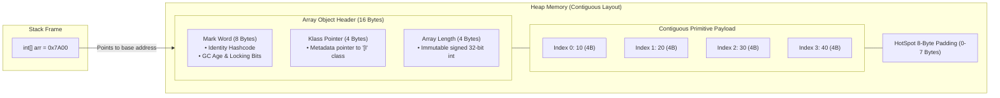

In Java, arrays are not compiler macros or primitive pointers—they are genuine, heap-allocated object instances synthesized dynamically by the JVM. Understanding their low-level memory footprint and CPU cache interactions explains why arrays remain the bedrock of high-performance Java systems.

---

## HotSpot Object Header Anatomy

While standard Java objects have a **12-byte header** on 64-bit JVMs with Compressed OOPs (Ordinary Object Pointers), an array object requires a **16-byte header**:



### Breakdown of the 16-Byte Header

1. **Mark Word (8 Bytes / 64 Bits)**:
   Stores object runtime state: identity hashcode, generational garbage collection age (up to 15 promotions), biased locking status, and thread lock synchronization pointers.
2. **Klass Pointer (4 Bytes with Compressed OOPs / 8 Bytes without)**:
   Points to the array class metadata in JVM Metaspace (e.g., `[I` for `int[]`).
3. **Array Length (4 Bytes / 32 Bits)**:
   Stores the number of elements as a signed 32-bit integer. Because length is physically embedded in the header:
   - `arr.length` is an instantaneous `O(1)` field access with zero method invocation overhead.
   - The theoretical limit of an array's size is constrained to `2^31 - 1` (`Integer.MAX_VALUE`).

---

## Memory Footprint & 8-Byte Alignment

HotSpot JVM aligns all heap object sizes to multiples of **8 bytes**. If the total byte count is not divisible by 8, padding bytes (0 to 7) are appended at the end:

```
Memory = align8(16 + (n * elementSize))
```

### Primitive Array vs Boxed Object Array Footprint

The contrast between primitive arrays and boxed object arrays demonstrates the dramatic cost of Java object overhead:

| Array Type                 | Length |   Raw Elements Payload   |              Object Overhead              |      Total Memory (Heap)      |
| :------------------------- | :----: | :----------------------: | :---------------------------------------: | :---------------------------: |
| `int[100]`                 |  100   |   `100 * 4 B = 400 B`    |                16 B header                |         **416 Bytes**         |
| `long[100]`                |  100   |   `100 * 8 B = 800 B`    |                16 B header                |         **816 Bytes**         |
| `Integer[100]`             |  100   | `100 * 4 B refs = 400 B` |        16 B header + `100 * 24 B`         | **2,816 Bytes** (~7× larger!) |
| `ArrayList<Integer>` (100) |  100   | `100 * 4 B refs = 400 B` | 24 B (List) + 16 B (array) + `100 * 24 B` |        **2,840 Bytes**        |

<Callout type="warn">
  **The Autoboxing Penalty**: An `Integer[100]` consumes nearly **700% more memory** than an
  `int[100]`. Each `Integer` is a full heap object with its own 12-byte header, 4-byte payload, and
  8-byte alignment padding (24 bytes total).
</Callout>

---

## CPU Cache Lines & Hardware Prefetching

Modern CPUs do not fetch single bytes from RAM; they load memory in **64-byte chunks called cache lines** into the L1/L2 data caches.

```mermaid
flowchart TD
    subgraph RAM["Physical RAM"]
        P_ARR["int[]: Sequential contiguous integers (4 bytes each)"]
        O_ARR["Integer[]: Array of 4-byte pointers -> Scattered heap objects"]
    end

    subgraph CACHE["CPU 64-Byte Cache Line"]
        CL["Holds 16 contiguous ints (64 bytes / 4 bytes = 16 elements)"]
    end

    subgraph CPU["CPU Execution Core"]
        CORE["Hardware Stream Prefetcher detects linear stride.<br/>Zero cache misses!"]
    end

    P_ARR -->|Single Memory Fetch| CL --> CORE
    O_ARR -.->|Pointer Dereference (Cache Miss)| CPU
```

### Why Primitive Arrays Beat Collections in Throughput

1. **Spatial Locality**: Fetching `arr[0]` automatically loads `arr[1]` through `arr[15]` into the L1 cache.
2. **Hardware Prefetching**: When the CPU notices a sequential stride through memory, the hardware prefetcher speculatively loads upcoming cache lines into L2/L1 cache before the loop instruction executes.
3. **Pointer Chasing with Objects**: Iterating through `Integer[]` or `LinkedList<Integer>` requires dereferencing pointers to arbitrary heap addresses. This stalls the CPU pipeline waiting for main memory (50–100 ns latency per cache miss).

---

## Synthesized Runtime Types & JVM Descriptors

Array classes are generated dynamically by HotSpot at runtime. Their runtime names follow JVM field type signatures:

| Java Array Declaration | Synthesized JVM Class Name | Superclass         | Implemented Interfaces      |
| :--------------------- | :------------------------- | :----------------- | :-------------------------- |
| `boolean[]`            | `[Z`                       | `java.lang.Object` | `Cloneable`, `Serializable` |
| `byte[]`               | `[B`                       | `java.lang.Object` | `Cloneable`, `Serializable` |
| `char[]`               | `[C`                       | `java.lang.Object` | `Cloneable`, `Serializable` |
| `short[]`              | `[S`                       | `java.lang.Object` | `Cloneable`, `Serializable` |
| `int[]`                | `[I`                       | `java.lang.Object` | `Cloneable`, `Serializable` |
| `long[]`               | `[J`                       | `java.lang.Object` | `Cloneable`, `Serializable` |
| `float[]`              | `[F`                       | `java.lang.Object` | `Cloneable`, `Serializable` |
| `double[]`             | `[D`                       | `java.lang.Object` | `Cloneable`, `Serializable` |
| `String[]`             | `[Ljava.lang.String;`      | `java.lang.Object` | `Cloneable`, `Serializable` |
| `int[][]`              | `[[I`                      | `java.lang.Object` | `Cloneable`, `Serializable` |
| `int[][][]`            | `[[[I`                     | `java.lang.Object` | `Cloneable`, `Serializable` |

```java title="ArrayReflectionDemo.java"
int[] nums = {1, 2, 3};
Class<?> clazz = nums.getClass();

System.out.println(clazz.getName());       // [I
System.out.println(clazz.getSuperclass()); // class java.lang.Object

for (Class<?> iface : clazz.getInterfaces()) {
    System.out.println(iface.getName());   // java.lang.Cloneable, java.io.Serializable
}
```

---

## Array Covariance vs Generic Invariance

Java arrays are **covariant**: if `Sub` is a subtype of `Super`, then `Sub[]` is considered a subtype of `Super[]`.

This design was introduced in Java 1.0 (before generics existed in Java 5) to allow reusable methods like `Arrays.sort(Object[])`. However, covariance introduces a runtime type vulnerability:

```java title="ArrayStoreExceptionDemo.java"
String[] strings = new String[5];
Object[] objects = strings; // Compiles due to array covariance

objects[0] = "Valid String";          // OK
objects[1] = Integer.valueOf(42);     // Compiles, but throws ArrayStoreException at runtime!
```

<Callout type="error">
  **Why ArrayStoreException Occurs**: Every array in the heap retains its runtime component type in
  its header metadata. When writing to an object array, the JVM performs an internal type check
  (`checkcast`). If the incoming object is incompatible with the array's true heap type, an
  `ArrayStoreException` is thrown.
</Callout>

### Comparison with Generics

| Feature               | Arrays (`T[]`)                              | Generics (`List<T>`)                                   |
| :-------------------- | :------------------------------------------ | :----------------------------------------------------- |
| **Type Relationship** | **Covariant** (`String[]` is an `Object[]`) | **Invariant** (`List<String>` is NOT a `List<Object>`) |
| **Type Verification** | **Reified** (checked at runtime by the JVM) | **Type Erasure** (erased to bounds at compile time)    |
| **Safety Invariant**  | Runtime failure (`ArrayStoreException`)     | Compile-time check (fails at compile time)             |

---

## HotSpot JVM Boundary Limits

### 1. Maximum Array Size (`Integer.MAX_VALUE - 8`)

Why does `new int[Integer.MAX_VALUE]` fail even with hundreds of gigabytes of heap?

```java title="MaxArrayLimit.java"
// Throws: java.lang.OutOfMemoryError: Requested array size exceeds VM limit
int[] max = new int[Integer.MAX_VALUE];
```

The HotSpot JVM reserves header metadata space inside the memory block. The practical maximum length is typically `Integer.MAX_VALUE - 8` (`2,147,483,639` elements).

### 2. Zero-Length Arrays

A zero-length array `new int[0]` still occupies **16 bytes** of heap (the 16-byte object header). When writing APIs that return empty arrays, declare a shared static immutable instance to eliminate garbage collection pressure:

```java title="EmptyArrayConstant.java"
public class DataService {
    // Avoid allocating new int[0] on every call
    public static final int[] EMPTY_INT_ARRAY = new int[0];

    public int[] fetchItems() {
        if (hasNoData()) {
            return EMPTY_INT_ARRAY; // Zero garbage collection overhead
        }
        return new int[]{1, 2, 3};
    }
}
```

---

## Interview & Deep-Dive FAQ

<Accordions>
  <Accordion title="Why is array.length a field and not a method like string.length()?">
    For arrays, `length` is physically stored in the 16-byte JVM object header at a fixed memory offset (byte offset 12). The JVM reads this 32-bit integer directly with a single CPU instruction (`arraylength` in bytecode) without creating a stack frame for a method call. For `String`, `length()` requires reading the length of the internal `byte[] value` array, which is encapsulated as a private method.
  </Accordion>

<Accordion title="What is False Sharing in multi-threaded array processing?">
  Because CPU cache lines are 64 bytes wide, two adjacent array slots (e.g., `arr[0]` and `arr[1]`)
  often reside on the exact same cache line. If Thread A repeatedly modifies `arr[0]` while Thread B
  reads `arr[1]`, the CPU's cache coherence protocol (MESI) constantly invalidates the cache line
  across CPU cores. This performance degradation is known as **false sharing**. It is resolved using
  padding or Java 8's `@jdk.internal.vm.annotation.Contended`.
</Accordion>

  <Accordion title="How do Compressed OOPs affect array memory?">
    On 64-bit systems with heaps under 32 GB, the HotSpot JVM enables Compressed OOPs (`-XX:+UseCompressedOops`). This encodes 64-bit memory addresses into 32-bit pointers by exploiting 8-byte object alignment (shifting bits by 3). This shrinks reference arrays (`String[]`, `Object[]`) from 8 bytes per slot down to 4 bytes per slot, yielding massive memory and cache bandwidth savings.
  </Accordion>
</Accordions>
