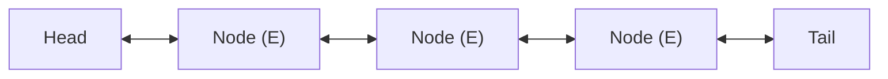

`LinkedList<E>` is composed of discrete heap nodes linked via `prev` and `next` pointers. Because it simultaneously implements both `List<E>` and `Deque<E>`, it can operate as a list, a FIFO queue, or a LIFO stack.

---

## Doubly-Linked Node Architecture



Unlike `ArrayList`, inserting or removing elements at either the head or tail does not require shifting elements in memory; it merely updates adjacent node pointers.

```java title="LinkedListUsage.java"
LinkedList<Integer> list = new LinkedList<>();

// 1. Double-ended insertion
list.addFirst(5);
list.addLast(20);

// 2. Inspection
int first = list.getFirst(); // 5 (throws if empty)
int last = list.getLast();   // 20 (throws if empty)
Integer safeFirst = list.peekFirst(); // 5 (null if empty)

// 3. Removal
int removedFirst = list.removeFirst(); // 5 (throws if empty)
int removedLast = list.removeLast();   // 20 (throws if empty)

// 4. As a FIFO Queue
Queue<Integer> queue = new LinkedList<>();
queue.offer(10);
queue.poll(); // 10
```

---

## Complexity Profile

| Operation                            | Time Complexity | Notes                                        |
| :----------------------------------- | :-------------: | :------------------------------------------- |
| **`addFirst()` / `addLast()`**       |     `O(1)`      | Pointer reassignment only                    |
| **`removeFirst()` / `removeLast()`** |     `O(1)`      | Pointer reassignment only                    |
| **`get(index)` / `set(index)`**      |     `O(n)`      | Must traverse pointers from nearest boundary |
| **`contains(Object)`**               |     `O(n)`      | Linear node scan                             |

<Callout type="error">
  **The Traversal Trap (`O(n^2)` Complexity)**: Never traverse a `LinkedList` using an index loop:
  ```java
  // ❌ SLOW: O(n^2) quadratic performance!
  for (int i = 0; i < list.size(); i++) {
      System.out.println(list.get(i)); // Traverses nodes from head on every iteration
  }
  
  // ✅ FAST: O(n) linear performance
  for (Integer val : list) {
      System.out.println(val); // Advances existing node pointer
  }
  ```
</Callout>
