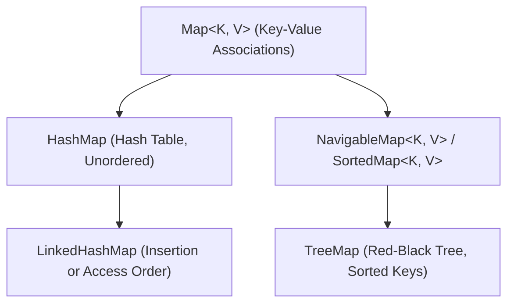

`Map<K, V>` represents a data structure that maps unique keys to values. Unlike `List` or `Set`, **`Map` does not implement `Collection` or `Iterable`**, because its contract concerns key-value associations rather than a single sequence of items.

---

## Map Hierarchy



| Class               | Key Ordering              | Access / Insert |    Null Key    |   Null Values    | Primary Application                      |
| :------------------ | :------------------------ | :-------------: | :------------: | :--------------: | :--------------------------------------- |
| **`HashMap`**       | None                      | `O(1)` average  |   1 allowed    | Multiple allowed | Default general-purpose key-value lookup |
| **`LinkedHashMap`** | Insertion or Access order | `O(1)` average  |   1 allowed    | Multiple allowed | Order-sensitive mapping; LRU caches      |
| **`TreeMap`**       | Sorted (Key ordering)     |   `O(log n)`    | **Disallowed** | Multiple allowed | Range queries, ceiling/floor lookups     |

---

## Live Collection Views

A map exposes three collection views backed directly by the map's internal data structures:

```java title="MapViews.java"
Map<String, Integer> map = new HashMap<>();
map.put("Alice", 90);
map.put("Bob", 80);

// 1. Key Set View
Set<String> keys = map.keySet(); // [Alice, Bob]

// 2. Values Collection View
Collection<Integer> scores = map.values(); // [90, 80]

// 3. Entry Set View (Key + Value pairs)
Set<Map.Entry<String, Integer>> entries = map.entrySet();

// Deleting through any view immediately mutates the map!
keys.remove("Alice");
System.out.println(map.containsKey("Alice")); // false
```

<Callout type="warn">
  **The `keySet()` + `get()` Anti-Pattern**: Never read values inside a `for (String key : map.keySet()) { val = map.get(key); }` loop! That pays for a second hash computation and bucket lookup for every iteration. Always iterate over **`map.entrySet()`** to receive both key and value in a single pass.
</Callout>

---

## Detailed Guides

<Cards>
  <Card
    icon={<LayoutGrid className="size-4" />}
    title="HashMap"
    description="Hash table bucket chaining, 8+ collision treeification, and null key handling"
    href="/archive/collections/maps/hash-map"
  />
  <Card
    icon={<ListOrdered className="size-4" />}
    title="LinkedHashMap"
    description="Insertion vs access ordering and building a production LRU cache"
    href="/archive/collections/maps/linked-hash-map"
  />
  <Card
    icon={<Sparkles className="size-4" />}
    title="TreeMap"
    description="NavigableMap contracts, sorted keys, range slices, and boundary lookups"
    href="/archive/collections/maps/tree-map"
  />
  <Card
    icon={<Code2 className="size-4" />}
    title="Java 8+ Functional Methods"
    description="Atomic read-compute-write methods: computeIfAbsent, computeIfPresent, merge, and getOrDefault"
    href="/archive/collections/maps/functional-methods"
  />
  <Card
    icon="RefreshCw"
    title="Iteration Patterns"
    description="The 6 canonical ways to iterate maps: entrySet vs keySet performance, lambdas, safe removal, and Streams"
    href="/archive/collections/maps/iteration"
  />
</Cards>
