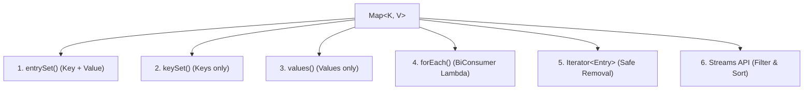

Iterating over a `Map<K, V>` in Java is fundamentally different from iterating over a `List` or `Set` because `Map` does **not** implement `Iterable`. Instead, iteration is performed through one of its three collection views (`entrySet()`, `keySet()`, `values()`), modern functional methods, or the Streams API.

---

## The 6 Canonical Ways to Iterate a Map



---

## 1. `entrySet()` with Enhanced For Loop (Default Choice)

This is the **most efficient and idiomatic** way to iterate over a map when you need both the key and the value. It extracts both in a single pass without extra hash lookups.

```java title="EntrySetIteration.java"
Map<String, Integer> scores = new HashMap<>();
scores.put("Alice", 95);
scores.put("Bob", 88);
scores.put("Charlie", 92);

for (Map.Entry<String, Integer> entry : scores.entrySet()) {
    String name = entry.getKey();
    Integer score = entry.getValue();
    System.out.println(name + " : " + score);
}
```

<Callout type="info">
  **Why `entrySet()` is Optimal**: In a hash map, each bucket already stores the key and value
  together in a single `Node` object. `entrySet()` visits each node directly, avoiding a second hash
  computation and bucket lookup.
</Callout>

---

## 2. `keySet()` with Enhanced For Loop (Keys Only)

Reach for `keySet()` **only** when your loop body only concerns keys, or when you plan to pass keys to external methods:

```java title="KeySetIteration.java"
for (String name : scores.keySet()) {
    System.out.println("Student: " + name);
}
```

<Callout type="error">
  **The `keySet()` + `get(k)` Anti-Pattern**:
  ```java
  // ❌ SUB-OPTIMAL: Double lookup per row!
  for (String key : map.keySet()) {
      Integer value = map.get(key); // Re-hashes key and traverses bucket again!
  }
  
  // ✅ OPTIMAL: Single pass!
  for (Map.Entry<String, Integer> entry : map.entrySet()) {
      Integer value = entry.getValue();
  }
  ```
</Callout>

---

## 3. `values()` with Enhanced For Loop (Values Only)

Use `values()` when you only need to process or aggregate values (e.g., calculating a sum or finding an average):

```java title="ValuesIteration.java"
int totalScore = 0;
for (int score : scores.values()) {
    totalScore += score;
}
System.out.println("Average: " + (double) totalScore / scores.size());
```

---

## 4. `forEach()` with BiConsumer Lambda (Cleanest Syntax)

Introduced in Java 8, `map.forEach()` is the cleanest and most concise option for short loop bodies:

```java title="ForEachLambda.java"
scores.forEach((name, score) -> {
    System.out.println(name + " earned " + score + " points");
});
```

---

## 5. `Iterator` via `entrySet().iterator()` (Safe In-Loop Removal)

Modifying a map directly inside an enhanced `for` loop throws a `ConcurrentModificationException`. To safely remove entries during traversal, use the iterator's own `remove()` method:

<Tabs items={['Iterator.remove() (Safe)', 'removeIf() (Java 8+ Cleanest)', 'Anti-Pattern (Crashes)']}>
  <Tab value="Iterator.remove() (Safe)">
    ```java title="SafeIteratorRemove.java"
    Iterator<Map.Entry<String, Integer>> it = scores.entrySet().iterator();

    while (it.hasNext()) {
        Map.Entry<String, Integer> entry = it.next();
        if (entry.getValue() < 90) {
            it.remove(); // Safely unlinks entry from the backing map
        }
    }
    ```

  </Tab>
  <Tab value="removeIf() (Java 8+ Cleanest)">
    ```java title="RemoveIfClean.java"
    // Modern Java 8+ equivalent:
    scores.entrySet().removeIf(entry -> entry.getValue() < 90);
    ```
  </Tab>
  <Tab value="Anti-Pattern (Crashes)">
    ```java title="ConcurrentModificationBug.java"
    // ❌ FAILS: Throws ConcurrentModificationException!
    for (Map.Entry<String, Integer> entry : scores.entrySet()) {
        if (entry.getValue() < 90) {
            scores.remove(entry.getKey()); // Modifies map directly!
        }
    }
    ```
  </Tab>
</Tabs>

---

## 6. Java Streams API (Filtering, Sorting, and Transforming)

The Streams API allows you to filter, transform, and sort map entries during iteration:

### Filter and Collect to a New Map

```java title="StreamFilter.java"
Map<String, Integer> highScorers = scores.entrySet().stream()
    .filter(e -> e.getValue() >= 90)
    .collect(Collectors.toMap(Map.Entry::getKey, Map.Entry::getValue));
```

### Iterate Sorted by Key

```java title="SortByKey.java"
scores.entrySet().stream()
    .sorted(Map.Entry.comparingByKey())
    .forEach(entry -> System.out.println(entry.getKey() + ": " + entry.getValue()));
```

### Iterate Sorted by Value (Descending)

```java title="SortByValue.java"
scores.entrySet().stream()
    .sorted(Map.Entry.<String, Integer>comparingByValue().reversed())
    .forEach(entry -> System.out.println(entry.getKey() + " -> " + entry.getValue()));
```

---

## Performance & Selection Summary

| Iteration Strategy                  | Time Overhead | Memory Overhead | Best Used For                                        |
| :---------------------------------- | :-----------: | :-------------: | :--------------------------------------------------- |
| **`entrySet()` loop**               |    `O(n)`     |      None       | **Default choice** when reading both keys and values |
| **`keySet()` loop**                 |    `O(n)`     |      None       | When only keys are needed in the loop                |
| **`values()` loop**                 |    `O(n)`     |      None       | Aggregating or inspecting values only                |
| **`forEach()` lambda**              |    `O(n)`     |      None       | Clean, concise read-only traversal                   |
| **`iterator()` with `it.remove()`** |    `O(n)`     |     Minimal     | Removing entries conditionally during iteration      |
| **`entrySet().removeIf()`**         |    `O(n)`     |      None       | Cleanest in-place conditional filtering              |
| **`entrySet().stream()`**           |    `O(n)`     | Stream pipeline | Filtering, complex sorting, and transforming         |
