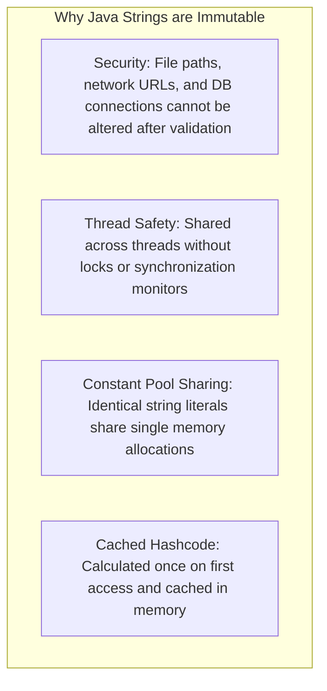
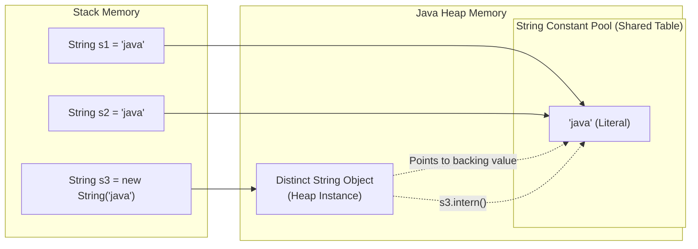

To optimize memory consumption and execution throughput, the Java Virtual Machine treats strings with special architectural privileges. Understanding the String Constant Pool, immutability guarantees, and Compact Strings reveals how Java executes string-heavy applications efficiently.

---

## String Immutability & Design Rationale

In Java, `String` is declared `public final class String`. Its internal character array is private and marked `final`. Once created, a `String` instance can never have its contents altered.



### 1. Cached HashCode Optimization

Because string contents never change, the 32-bit hash code is calculated lazily once and cached in the private field `private int hash;`:

```java title="StringHashCodeCaching.java"
String key = "customer_transaction_id_982341";

// First call: Computes polynomial hash O(n) and stores in 'hash' field
int h1 = key.hashCode();

// Subsequent calls: Instant O(1) field lookup
int h2 = key.hashCode();
```

This caching makes `String` the most optimal and ubiquitous key datatype for `HashMap` and `HashSet`.

### 2. Security & Class Loading Integrity

Class loaders pass class names as strings to load bytecode. If strings were mutable, a malicious thread could change `"java.lang.Object"` to `"com.attacker.FakeObject"` between the security verification check and actual class loading.

---

## The String Constant Pool (SCP)

The String Constant Pool is a specialized hashtable managed internally by the JVM inside the **Java Heap** (migrated out of PermGen starting in Java 7).



### Literals vs `new String()`

```java title="StringPoolDemo.java"
String a = "java";
String b = "java";
String c = new String("java");

// 1. Reference Identity (Address Comparison)
System.out.println(a == b);      // true  (Both point to the same pooled instance)
System.out.println(a == c);      // false (c is an independent heap object)

// 2. Content Equality (Character Comparison)
System.out.println(a.equals(c)); // true  (Character content is identical)

// 3. String Interning
String d = c.intern();
System.out.println(a == d);      // true  (intern returns reference from pool)
```

### The `intern()` Contract

When calling `str.intern()`:

- If the pool already contains a string equal to `str` (via `equals()`), the reference from the pool is returned.
- If not, `str` is added to the pool and a reference to `str` is returned.

---

## Equality & Comparison Rules

| Comparison Method          | Checks For             | Return Type | Contract / Behavior                                                  |
| :------------------------- | :--------------------- | :---------: | :------------------------------------------------------------------- |
| `a == b`                   | Reference Identity     |  `boolean`  | `true` only if both variables point to the exact same memory address |
| `a.equals(b)`              | Content Equality       |  `boolean`  | `true` if character sequences match exactly                          |
| `a.equalsIgnoreCase(b)`    | Case-Insensitive       |  `boolean`  | Matches content while ignoring case differences                      |
| `a.compareTo(b)`           | Lexicographical Order  |    `int`    | Negative (`a < b`), Zero (`a.equals(b)`), or Positive (`a > b`)      |
| `a.compareToIgnoreCase(b)` | Case-Insensitive Order |    `int`    | Lexicographical comparison ignoring ASCII case                       |

```java title="ComparisonExamples.java"
String s1 = "apple";
String s2 = "banana";

System.out.println(s1.compareTo(s2)); // Negative ('a' comes before 'b')
System.out.println(s2.compareTo(s1)); // Positive ('b' comes after 'a')
System.out.println(s1.compareTo("apple")); // 0 (equal)
```

---

## Compact Strings (Java 9+)

Prior to Java 9, every `String` was backed by a 16-bit character array:

```java
// Pre-Java 9 Internal Storage
private final char[] value; // 2 bytes per character regardless of encoding
```

In the vast majority of enterprise applications, strings consist predominantly of single-byte ASCII or Latin-1 characters. Allocating 2 bytes per character wasted ~50% of heap memory.

### Compact Strings Implementation

Since Java 9, HotSpot replaced `char[]` with a compressed `byte[]` accompanied by a 1-byte encoding flag:

```java
// Modern Java 9+ Internal Storage
private final byte[] value; // Byte array
private final byte coder;   // LATIN1 (0) or UTF16 (1)
```

- **LATIN1 (`0`)**: Used when every character fits in 1 byte (ISO-8859-1 / ASCII). Each character takes only **1 byte**.
- **UTF16 (`1`)**: Automatically enabled if even a single character exceeds 1 byte (e.g., Chinese characters, emoji). Characters are stored as 2 bytes.

<Callout type="info">
  **Transparent Optimization**: Compact Strings requires zero configuration or code changes. The JVM
  manages compression and decompression entirely within intrinsic assembly routines.
</Callout>

---

## Deep-Dive Interview FAQ

<Accordions>
  <Accordion title="Why is char[] preferred over String for storing passwords?">
    Because `String` is immutable, once a password string is created, it remains in heap memory until the Garbage Collector runs. If memory is dumped (e.g., crash dump or memory scraping exploit), the plain-text password can be discovered. In contrast, a `char[]` array is mutable—after authenticating, developers can immediately overwrite the array with zeros (`Arrays.fill(password, '0')`), clearing sensitive data from RAM.
  </Accordion>

  <Accordion title="How does String.hashCode() compute its value?">
    The Java `String.hashCode()` algorithm uses polynomial evaluation with a multiplier of 31:
    
    `hash = s[0]*31^(n-1) + s[1]*31^(n-2) + ... + s[n-1]`
    
    The prime number 31 was chosen because multiplication by 31 can be optimized by modern compilers into a single CPU bit-shift and subtraction instruction: `31 * i == (i << 5) - i`.
  </Accordion>

  <Accordion title="Does String interning cause OutOfMemoryError in modern Java?">
    In Java 6 and earlier, the String Constant Pool was located in **PermGen**, which had a fixed size (typically 64 MB) and was rarely garbage-collected. Calling `intern()` excessively on dynamically generated strings frequently caused `OutOfMemoryError: PermGen space`. Since Java 7, the pool is stored in the standard **Java Heap** and unused pooled strings are collected during standard garbage collection cycles.
  </Accordion>
</Accordions>
