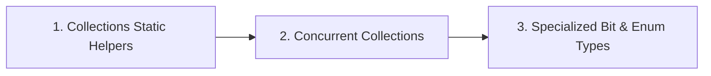

Beyond the standard collection classes, the Java platform provides polymorphic static algorithms, factory methods for unmodifiable collections, and high-performance concurrent collections in `java.util.concurrent`.

---

## Roadmap

---

## Detailed Guides

<Cards>
  <Card
    icon={<Cpu className="size-4" />}
    title="Collections Helper Class"
    description="Polymorphic sorting, shuffling, unmodifiable wrappers, and immutable List.of/Set.of/Map.of factories"
    href="/archive/collections/utilities/collections-class"
  />
  <Card
    icon={<Layers className="size-4" />}
    title="Concurrent Collections"
    description="ConcurrentHashMap lock striping, CopyOnWriteArrayList snapshot iteration, and obsolete Hashtable"
    href="/archive/collections/utilities/concurrent-collections"
  />
  <Card
    icon={<Sparkles className="size-4" />}
    title="Specialized Types & Autoboxing"
    description="EnumSet bit vectors, EnumMap, BitSet flag packing, and avoiding autoboxing overhead in hot loops"
    href="/archive/collections/utilities/specialized-types"
  />
</Cards>
