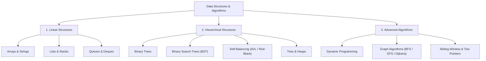

Welcome to the **Data Structures & Algorithms (DSA)** section. This reference provides production-grade explanations, space/time complexity analyses, visual ASCII and Mermaid architectures, and canonical Java implementations for technical assessments and system design.

---

## DSA Knowledge Map

---

## Featured Topics

<Cards>
  <Card
    icon="Link"
    title="Linked Lists"
    description="Singly/doubly linked nodes, Floyd's cycle detection, two pointers, in-place reversal, and LRU cache unlinking"
    href="/archive/dsa/linked-lists"
  />
  <Card
    icon="FolderTree"
    title="Trees"
    description="Binary trees, DFS/BFS traversals, BST validation & 3-case deletion, AVL rotations, and canonical problem patterns"
    href="/archive/dsa/trees"
  />
  <Card
    icon="LayoutGrid"
    title="Collections Framework"
    description="Java Collection implementations, ArrayList resizing, HashMap treeification, and performance tradeoffs"
    href="/archive/collections"
  />
  <Card
    icon="Sparkles"
    title="Exam Prep & DSA Snippets"
    description="12 core problem archetypes, Two Sum, Monotonic Stack, Top-K, and return-type trap drills"
    href="/archive/dsa/exam-prep"
  />
</Cards>
