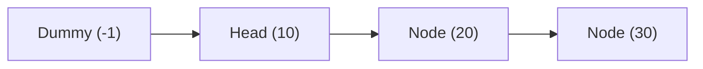
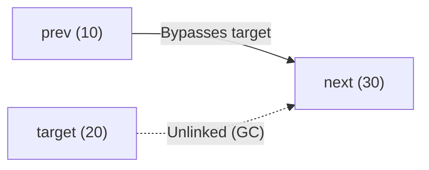

Every linked list operation boils down to modifying reference pointers without losing references to the rest of the chain. This guide covers fundamental pointer mechanics and the industry-standard sentinel pattern.

---

## The Sentinel (Dummy Head) Pattern

In linked list algorithms, modifying the first node (`head`) typically requires cumbersome `if (head == null)` or `if (target == head)` edge-case branches.

The **Sentinel (Dummy Head)** technique creates an artificial placeholder node positioned directly before the actual head:



```java title="SentinelPattern.java"
ListNode dummy = new ListNode(-1);
dummy.next = head;

// Any manipulation (inserting at head, deleting head) is now identical
// to manipulating any normal internal node!

// Return the true head at the conclusion:
return dummy.next;
```

<Callout type="info">
  **Why Dummy Heads Are Mandatory in Interviews**: It guarantees that the node to be inserted or
  removed **always has a non-null predecessor** (`prev`), eliminating null-pointer exceptions and
  messy special cases.
</Callout>

---

## 1. Insertion Operations

<Tabs items={['Insert at Head (O(1))', 'Insert at Tail', 'Insert at Index k']}>
  <Tab value="Insert at Head (O(1))">
    ```java title="InsertAtHead.java"
    public ListNode insertAtHead(ListNode head, int val) {
        ListNode newNode = new ListNode(val);
        newNode.next = head;
        return newNode; // New node is now the head
    }
    ```
    **Time Complexity**: `O(1)` instantaneous pointer assignment.
  </Tab>

  <Tab value="Insert at Tail">
    ```java title="InsertAtTail.java"
    public ListNode insertAtTail(ListNode head, int val) {
        ListNode newNode = new ListNode(val);
        if (head == null) return newNode;

        ListNode curr = head;
        while (curr.next != null) {
            curr = curr.next;
        }

        curr.next = newNode;
        return head;
    }
    ```
    **Time Complexity**: `O(n)` traversal without tail pointer; `O(1)` if a `tail` pointer is maintained.

  </Tab>

  <Tab value="Insert at Index k">
    ```java title="InsertAtIndex.java"
    public ListNode insertAtIndex(ListNode head, int index, int val) {
        ListNode dummy = new ListNode(0);
        dummy.next = head;
        ListNode curr = dummy;

        for (int i = 0; i < index && curr != null; i++) {
            curr = curr.next;
        }

        if (curr != null) {
            ListNode newNode = new ListNode(val);
            newNode.next = curr.next;
            curr.next = newNode;
        }

        return dummy.next;
    }
    ```
    **Time Complexity**: `O(k)` traversal + `O(1)` pointer insertion.

  </Tab>
</Tabs>

---

## 2. Deletion Operations

To delete a target node, locate the node **immediately preceding it** (`prev`), and bypass the target by linking `prev.next = target.next`.



### Delete by Value

```java title="DeleteByValue.java"
public ListNode removeElements(ListNode head, int targetVal) {
    ListNode dummy = new ListNode(0);
    dummy.next = head;
    ListNode curr = dummy;

    while (curr.next != null) {
        if (curr.next.val == targetVal) {
            curr.next = curr.next.next; // Bypass matching node
        } else {
            curr = curr.next;
        }
    }

    return dummy.next;
}
```

---

## 3. Delete Node Without Access to Head (Interview Trick)

Suppose you are given access only to the node that needs to be deleted, with **no reference to the `head` pointer**:

```java title="DeleteNodeInPlace.java"
public void deleteNode(ListNode node) {
    // Copy the value of the next node into current node
    node.val = node.next.val;

    // Bypass the next node
    node.next = node.next.next;
}
```

<Callout type="warn">
  **Limitation**: This trick cannot be used if the node to delete is the **very last tail node** of
  the list (since `node.next == null`).
</Callout>

---

## 4. Doubly Linked List Pointer Mechanics

In a `DoublyListNode`, every node maintains both `prev` and `next` pointers. This allows **`O(1)` instant deletion** of any node without needing to traverse to find its predecessor:

```java title="DoublyLinkedListOperations.java"
// Delete a given node in O(1) time
public void removeNode(DoublyListNode node) {
    DoublyListNode prevNode = node.prev;
    DoublyListNode nextNode = node.next;

    if (prevNode != null) {
        prevNode.next = nextNode;
    }
    if (nextNode != null) {
        nextNode.prev = prevNode;
    }

    // Detach node references for garbage collection
    node.prev = null;
    node.next = null;
}

// Insert newNode immediately after targetNode in O(1) time
public void insertAfter(DoublyListNode targetNode, DoublyListNode newNode) {
    newNode.next = targetNode.next;
    newNode.prev = targetNode;

    if (targetNode.next != null) {
        targetNode.next.prev = newNode;
    }
    targetNode.next = newNode;
}
```

---

## Complexity Profile of Core Operations

| Operation             |        Singly Linked List         | Singly List (with Tail) |   Doubly Linked List    |      Array (`ArrayList`)      |
| :-------------------- | :-------------------------------: | :---------------------: | :---------------------: | :---------------------------: |
| **Insert at Head**    |              `O(1)`               |         `O(1)`          |         `O(1)`          |            `O(n)`             |
| **Insert at Tail**    |              `O(n)`               |         `O(1)`          |         `O(1)`          |       `O(1)` amortized        |
| **Delete Head**       |              `O(1)`               |         `O(1)`          |         `O(1)`          |            `O(n)`             |
| **Delete Tail**       | `O(n)` (must find second-to-last) |         `O(n)`          |   `O(1)` (with tail)    |            `O(1)`             |
| **Delete Given Node** |              `O(n)`               |         `O(n)`          | `O(1)` (direct pointer) |            `O(n)`             |
| **Search by Value**   |              `O(n)`               |         `O(n)`          |         `O(n)`          | `O(n)` (or `O(log n)` sorted) |
| **Get by Index**      |              `O(n)`               |         `O(n)`          |         `O(n)`          |            `O(1)`             |
