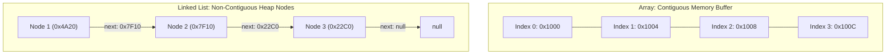
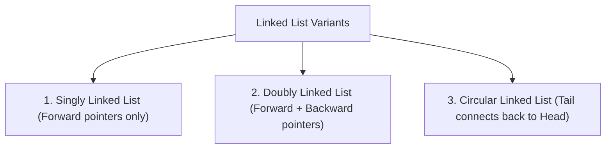

A **Linked List** is a fundamental linear data structure in which elements (called **nodes**) are stored non-contiguously in heap memory. Instead of relying on physical memory offsets like an array, each node encapsulates a data payload and one or more **reference pointers** pointing to neighboring nodes.

---

## Memory Architecture: Array vs Linked List



### Architectural Trade-offs

| Criterion                     | Array (`int[]` / `ArrayList`)                               | Linked List (`ListNode`)                                      |
| :---------------------------- | :---------------------------------------------------------- | :------------------------------------------------------------ |
| **Physical Memory**           | Contiguous, pre-allocated memory block                      | Dispersed nodes on JVM heap                                   |
| **Element Access (`get(i)`)** | **`O(1)`** direct memory address calculation                | **`O(n)`** sequential pointer traversal                       |
| **Head Insertion / Deletion** | `O(n)` (must shift entire buffer right/left)                | **`O(1)`** (rewire single reference pointer)                  |
| **Tail Append**               | `O(1)` amortized                                            | `O(1)` (with tail reference) or `O(n)`                        |
| **Memory Overhead**           | Minimal (pure data values)                                  | **High** (additional 8-byte reference pointer per node)       |
| **Cache Locality**            | **High spatial locality** (prefetches into L1/L2 CPU cache) | **Poor cache locality** (pointer chasing causes cache misses) |
| **Resizing**                  | Requires new buffer allocation + copy (`O(n)`)              | Naturally dynamic (allocates nodes on demand)                 |

---

## Primary Linked List Variants



### 1. Singly Linked List

Each node points strictly to the next node. Traversal is strictly unidirectional:

```
[ Head: 10 ] ---> [ 20 ] ---> [ 30 ] ---> null
```

```java title="ListNode.java"
public class ListNode {
    public int val;
    public ListNode next;

    public ListNode() {}
    public ListNode(int val) { this.val = val; }
    public ListNode(int val, ListNode next) {
        this.val = val;
        this.next = next;
    }
}
```

### 2. Doubly Linked List

Each node contains two pointers: `prev` and `next`. Allows bidirectional traversal and `O(1)` node removal when a direct node reference is held:

```
null <--- [ Head: 10 ] <===> [ 20 ] <===> [ Tail: 30 ] ---> null
```

```java title="DoublyListNode.java"
public class DoublyListNode {
    public int val;
    public DoublyListNode prev;
    public DoublyListNode next;

    public DoublyListNode(int val) {
        this.val = val;
    }
}
```

### 3. Circular Linked List

The final node's `next` pointer references the `head` node rather than `null`. Common in round-robin task schedulers and audio playback loops:

```
[ Head: 10 ] ---> [ 20 ] ---> [ Tail: 30 ]
     ^                              |
     |------------------------------|
```

---

## Detailed Guides

<Cards>
  <Card
    icon="RefreshCw"
    title="Core Operations"
    description="Insertion, deletion, index traversal, and edge-case elimination with sentinel dummy heads"
    href="/archive/dsa/linked-lists/core-operations"
  />
  <Card
    icon="Binary"
    title="Two Pointers & Cycle Detection"
    description="Floyd's Tortoise and Hare algorithm, cycle entry point detection, finding the middle, and list intersection"
    href="/archive/dsa/linked-lists/two-pointers"
  />
  <Card
    icon="Sparkles"
    title="In-Place Reversal & Slicing"
    description="Pointer rewiring algorithms for full reversal, sublist slicing, reverse in k-groups, and palindrome checks"
    href="/archive/dsa/linked-lists/manipulation"
  />
  <Card
    icon="Code2"
    title="Canonical Problem Patterns"
    description="Merging sorted lists, LRU cache doubly-linked node unlinking, and deep copying lists with random pointers"
    href="/archive/dsa/linked-lists/problem-patterns"
  />
</Cards>
