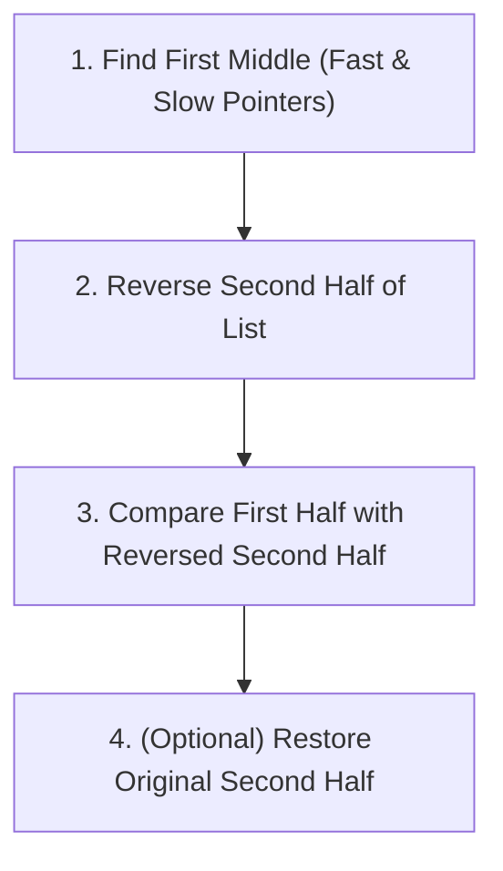

In-place linked list manipulation requires rewiring references without allocating new `ListNode` instances, achieving optimal `O(1)` auxiliary space.

---

## 1. Reversing a Linked List

Reversing a singly linked list requires flipping every node's `next` pointer to point to its predecessor instead of its successor:

```mermaid
flowchart LR
    subgraph Original ["Original: 1 -> 2 -> 3 -> null"]
        O1["1"] --> O2["2"] --> O3["3"] --> ONULL["null"]
    end
    subgraph Reversed ["Reversed: null <- 1 <- 2 <- 3"]
        RNULL["null"] <-- R1["1"] <-- R2["2"] <-- R3["3 (New Head)"]
    end
```

<Tabs items={['Iterative (3 Pointers - O(1) Space)', 'Recursive (O(n) Call Stack)']}>
  <Tab value="Iterative (3 Pointers - O(1) Space)">
    Maintain three pointers: `prev` (already reversed chain), `curr` (current node), and `nextTemp` (saved forward reference):

    ```java title="ReverseListIterative.java"
    public ListNode reverseList(ListNode head) {
        ListNode prev = null;
        ListNode curr = head;

        while (curr != null) {
            ListNode nextTemp = curr.next; // 1. Save forward pointer
            curr.next = prev;              // 2. Reverse link
            prev = curr;                   // 3. Advance prev
            curr = nextTemp;               // 4. Advance curr
        }

        return prev; // prev now points to the new head
    }
    ```

  </Tab>

  <Tab value="Recursive (O(n) Call Stack)">
    ```java title="ReverseListRecursive.java"
    public ListNode reverseList(ListNode head) {
        // Base case: empty list or single node
        if (head == null || head.next == null) {
            return head;
        }

        // Recursively reverse remaining sublist
        ListNode newHead = reverseList(head.next);

        // Rewire pointers
        head.next.next = head; // Child points back to parent
        head.next = null;      // Sever original forward reference

        return newHead;
    }
    ```

  </Tab>
</Tabs>

---

## 2. Reversing a Sublist (Reverse Linked List II)

Reverse the nodes of a list between positions `left` and `right` (1-indexed) in a single pass:

```java title="ReverseBetween.java"
public ListNode reverseBetween(ListNode head, int left, int right) {
    if (head == null || left == right) return head;

    ListNode dummy = new ListNode(0);
    dummy.next = head;
    ListNode prev = dummy;

    // 1. Advance prev to the node immediately preceding 'left'
    for (int i = 1; i < left; i++) {
        prev = prev.next;
    }

    // 2. Sublist reversal by repeatedly shifting 'curr.next' to the front
    ListNode curr = prev.next;
    for (int i = 0; i < right - left; i++) {
        ListNode nextTemp = curr.next;
        curr.next = nextTemp.next;
        nextTemp.next = prev.next;
        prev.next = nextTemp;
    }

    return dummy.next;
}
```

---

## 3. Reverse Nodes in k-Group (Hard)

Given a linked list, reverse the nodes of the list `k` at a time, leaving remaining nodes untouched if fewer than `k` nodes remain:

```java title="ReverseKGroup.java"
public ListNode reverseKGroup(ListNode head, int k) {
    ListNode dummy = new ListNode(0);
    dummy.next = head;
    ListNode prevGroupTail = dummy;

    while (true) {
        // 1. Check if at least k nodes remain
        ListNode kth = getKthNode(prevGroupTail, k);
        if (kth == null) break;

        ListNode nextGroupHead = kth.next;

        // 2. Reverse current k-group
        ListNode prev = nextGroupHead;
        ListNode curr = prevGroupTail.next;

        while (curr != nextGroupHead) {
            ListNode temp = curr.next;
            curr.next = prev;
            prev = curr;
            curr = temp;
        }

        // 3. Connect previous group to reversed group
        ListNode groupStart = prevGroupTail.next;
        prevGroupTail.next = kth;
        prevGroupTail = groupStart;
    }

    return dummy.next;
}

private ListNode getKthNode(ListNode curr, int k) {
    while (curr != null && k > 0) {
        curr = curr.next;
        k--;
    }
    return curr;
}
```

---

## 4. Palindrome Linked List

Determine if a singly linked list is a palindrome in `O(n)` time and `O(1)` auxiliary space:



```java title="IsPalindrome.java"
public boolean isPalindrome(ListNode head) {
    if (head == null || head.next == null) return true;

    // 1. Find the first middle node
    ListNode firstHalfEnd = endOfFirstHalf(head);

    // 2. Reverse the second half
    ListNode secondHalfStart = reverseList(firstHalfEnd.next);

    // 3. Compare values
    ListNode p1 = head;
    ListNode p2 = secondHalfStart;
    boolean isPal = true;

    while (isPal && p2 != null) {
        if (p1.val != p2.val) isPal = false;
        p1 = p1.next;
        p2 = p2.next;
    }

    // 4. Restore original list structure
    firstHalfEnd.next = reverseList(secondHalfStart);

    return isPal;
}

private ListNode endOfFirstHalf(ListNode head) {
    ListNode fast = head;
    ListNode slow = head;
    while (fast.next != null && fast.next.next != null) {
        fast = fast.next.next;
        slow = slow.next;
    }
    return slow;
}

private ListNode reverseList(ListNode head) {
    ListNode prev = null;
    ListNode curr = head;
    while (curr != null) {
        ListNode temp = curr.next;
        curr.next = prev;
        prev = curr;
        curr = temp;
    }
    return prev;
}
```

---

## 5. Reorder List (L0 -> Ln -> L1 -> Ln-1)

Rearrange `[1, 2, 3, 4, 5]` into alternating order `[1, 5, 2, 4, 3]`:

```java title="ReorderList.java"
public void reorderList(ListNode head) {
    if (head == null || head.next == null) return;

    // 1. Split in half
    ListNode slow = head;
    ListNode fast = head;
    while (fast.next != null && fast.next.next != null) {
        slow = slow.next;
        fast = fast.next.next;
    }

    // 2. Reverse second half
    ListNode prev = null;
    ListNode curr = slow.next;
    slow.next = null; // Sever halves

    while (curr != null) {
        ListNode temp = curr.next;
        curr.next = prev;
        prev = curr;
        curr = temp;
    }

    // 3. Interleave two lists (head and prev)
    ListNode first = head;
    ListNode second = prev;

    while (second != null) {
        ListNode tmp1 = first.next;
        ListNode tmp2 = second.next;

        first.next = second;
        second.next = tmp1;

        first = tmp1;
        second = tmp2;
    }
}
```
