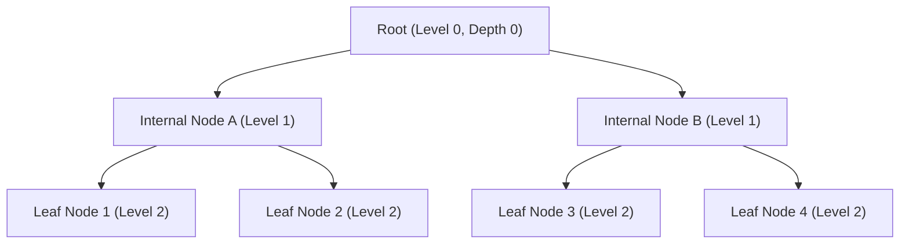
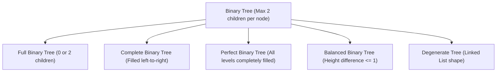

A **Tree** is a non-linear, hierarchical data structure composed of nodes connected by directed or undirected edges. Unlike linear structures (arrays, linked lists, stacks, and queues) where elements are traversed sequentially, trees organize data in parent-child hierarchies.

---

## Tree Terminology



| Term                     | Definition                                                                          |
| :----------------------- | :---------------------------------------------------------------------------------- |
| **Root**                 | The topmost node of the tree with no parent.                                        |
| **Edge**                 | The link or pointer connecting a parent node to its child.                          |
| **Parent & Child**       | A node directly above another is its parent; nodes directly below are its children. |
| **Leaf (External Node)** | A node that has no children (both left and right pointers are `null`).              |
| **Internal Node**        | A node with at least one non-null child.                                            |
| **Depth of a Node**      | The number of edges along the path from the root to that node (`root` has depth 0). |
| **Height of a Node**     | The number of edges on the longest downward path from that node to a leaf.          |
| **Height of a Tree**     | The height of the root node (i.e. length of the longest root-to-leaf path).         |
| **Subtree**              | Any node together with all its descendants.                                         |

---

## Java `TreeNode` Representation

In Java, binary trees are typically modeled using reference-linked objects:

```java title="TreeNode.java"
public class TreeNode {
    public int val;
    public TreeNode left;
    public TreeNode right;

    public TreeNode() {}

    public TreeNode(int val) {
        this.val = val;
    }

    public TreeNode(int val, TreeNode left, TreeNode right) {
        this.val = val;
        this.left = left;
        this.right = right;
    }
}
```

<Callout type="info">
  **Memory Overhead**: Each `TreeNode` object incurs object header overhead plus two 64-bit object
  references (`left` and `right`). For `n` nodes, there are exactly `n + 1` `null` pointers across
  all leaf and single-child nodes.
</Callout>

---

## Binary Tree Classifications



| Classification                | Structural Invariant                                                                               | Practical Significance                                                                           |
| :---------------------------- | :------------------------------------------------------------------------------------------------- | :----------------------------------------------------------------------------------------------- |
| **Full (Strict) Binary Tree** | Every node has either **0 or 2 children**. No node has exactly 1 child.                            | Used in Huffman coding and compression trees.                                                    |
| **Complete Binary Tree**      | All levels are completely filled except possibly the last, which is filled from **left to right**. | **Foundation for Binary Heaps** (`PriorityQueue`), allowing flat array storage without pointers. |
| **Perfect Binary Tree**       | All internal nodes have 2 children, and all leaves reside on the **exact same level**.             | Contains exactly `2^(h+1) - 1` total nodes where `h` is height.                                  |
| **Balanced Binary Tree**      | For every node, the height difference between left and right subtrees is **`<= 1`**.               | Guarantees worst-case `O(log n)` search, insert, and delete.                                     |
| **Degenerate (Skewed) Tree**  | Every internal node has only 1 child, degrading into a single chain.                               | Degrades search operations to linear `O(n)` time.                                                |

---

## Mathematical Properties of Binary Trees

<Accordions>
  <Accordion title="1. Maximum Nodes per Level">
    At level `L` (where root is level 0), the maximum possible number of nodes is:
    ```
    Max Nodes = 2^L
    ```
    - Level 0: `2^0 = 1`
    - Level 1: `2^1 = 2`
    - Level 2: `2^2 = 4`
    - Level `L`: `2^L`
  </Accordion>

<Accordion title="2. Maximum Total Nodes for Height h">
  For a binary tree of height `h` (where a single-node tree has height 0), the maximum total nodes
  is: ``` N_max = 2^(h + 1) - 1 ``` For example, height 2 has `2^(2+1) - 1 = 7` nodes.
</Accordion>

<Accordion title="3. Minimum Height for n Nodes">
  To store `n` nodes in a binary tree, the minimum possible height is: ``` h_min = floor(log2(n))
  ``` This logarithmic lower bound explains why balanced binary search trees achieve `O(log n)`
  operations.
</Accordion>

  <Accordion title="4. Leaf Nodes vs Degree-2 Nodes (Handshaking Lemma)">
    In any non-empty binary tree, if `n_0` is the number of leaf nodes (degree 0) and `n_2` is the number of nodes with 2 children (degree 2):
    ```
    n_0 = n_2 + 1
    ```
    The number of leaves is always exactly one greater than the number of nodes with two children.
  </Accordion>
</Accordions>

---

## Detailed Guides

<Cards>
  <Card
    icon="RefreshCw"
    title="Traversals & BFS/DFS"
    description="Preorder, Inorder, Postorder depth-first and level-order breadth-first traversals (recursive and iterative)"
    href="/archive/dsa/trees/traversals"
  />
  <Card
    icon="Binary"
    title="Binary Search Trees"
    description="The BST sorted invariant, logarithmic search, insert, 3-case deletion, and boundary validation"
    href="/archive/dsa/trees/binary-search-tree"
  />
  <Card
    icon="Sparkles"
    title="Self-Balancing & Advanced Trees"
    description="AVL tree rotations, Red-Black tree properties (TreeMap/HashMap), and Trie prefix structures"
    href="/archive/dsa/trees/advanced-trees"
  />
  <Card
    icon="Code2"
    title="Problem Patterns & Algorithms"
    description="Canonical algorithms for tree diameter, Lowest Common Ancestor (LCA), path sums, and mirror trees"
    href="/archive/dsa/trees/problem-patterns"
  />
</Cards>
