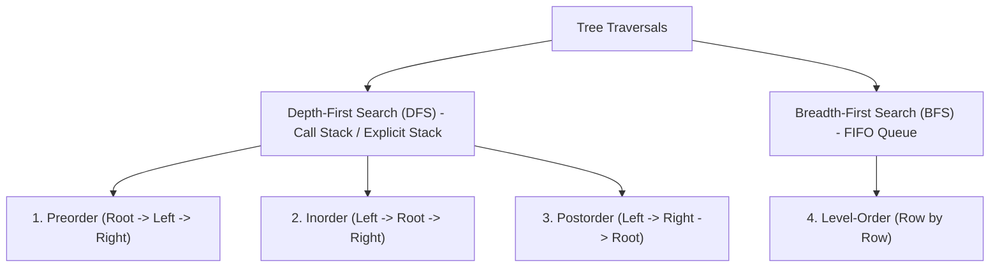

Tree traversal refers to the process of visiting (inspecting or updating) each node in a tree data structure exactly once. Traversals are categorized into **Depth-First Search (DFS)** and **Breadth-First Search (BFS)**.

---

## The Four Primary Traversals



Consider the following sample tree:

```
        1
       / \
      2   3
     / \
    4   5
```

- **Preorder** (Root, Left, Right): `1, 2, 4, 5, 3`
- **Inorder** (Left, Root, Right): `4, 2, 5, 1, 3`
- **Postorder** (Left, Right, Root): `4, 5, 2, 3, 1`
- **Level-Order** (Breadth-first): `1, 2, 3, 4, 5`

---

## 1. Depth-First Traversals (Recursive)

Recursive implementations leverage the implicit JVM call stack:

<Tabs items={['Preorder', 'Inorder', 'Postorder']}>
  <Tab value="Preorder">
    ```java title="PreorderRecursive.java"
    // Root -> Left -> Right
    public void preorder(TreeNode root, List<Integer> result) {
        if (root == null) return;

        result.add(root.val);         // 1. Visit root
        preorder(root.left, result);  // 2. Traverse left
        preorder(root.right, result); // 3. Traverse right
    }
    ```
    **Key Applications**: Tree copying, expression prefix evaluation, tree serialization.

  </Tab>

  <Tab value="Inorder">
    ```java title="InorderRecursive.java"
    // Left -> Root -> Right
    public void inorder(TreeNode root, List<Integer> result) {
        if (root == null) return;

        inorder(root.left, result);   // 1. Traverse left
        result.add(root.val);         // 2. Visit root
        inorder(root.right, result);  // 3. Traverse right
    }
    ```
    **Key Applications**: In a **Binary Search Tree (BST)**, inorder traversal visits elements in **strictly increasing sorted order**.

  </Tab>

  <Tab value="Postorder">
    ```java title="PostorderRecursive.java"
    // Left -> Right -> Root
    public void postorder(TreeNode root, List<Integer> result) {
        if (root == null) return;

        postorder(root.left, result);   // 1. Traverse left
        postorder(root.right, result);  // 2. Traverse right
        result.add(root.val);           // 3. Visit root
    }
    ```
    **Key Applications**: Bottom-up computation (calculating height, diameter), deleting a tree (subtrees must be deleted before root).

  </Tab>
</Tabs>

---

## 2. Iterative Depth-First Traversals (Explicit Stack)

Iterative DFS replaces the JVM call stack with an explicit `Deque<TreeNode>` to prevent `StackOverflowError` on deep or degenerate trees:

<Tabs items={['Iterative Inorder (High Frequency)', 'Iterative Preorder', 'Iterative Postorder (2 Stacks)']}>
  <Tab value="Iterative Inorder (High Frequency)">
    ```java title="IterativeInorder.java"
    public List<Integer> inorderTraversal(TreeNode root) {
        List<Integer> result = new ArrayList<>();
        Deque<TreeNode> stack = new ArrayDeque<>();
        TreeNode curr = root;

        while (curr != null || !stack.isEmpty()) {
            // 1. Traverse left as deep as possible
            while (curr != null) {
                stack.push(curr);
                curr = curr.left;
            }

            // 2. Pop node and visit
            curr = stack.pop();
            result.add(curr.val);

            // 3. Switch to right subtree
            curr = curr.right;
        }

        return result;
    }
    ```

  </Tab>

  <Tab value="Iterative Preorder">
    ```java title="IterativePreorder.java"
    public List<Integer> preorderTraversal(TreeNode root) {
        List<Integer> result = new ArrayList<>();
        if (root == null) return result;

        Deque<TreeNode> stack = new ArrayDeque<>();
        stack.push(root);

        while (!stack.isEmpty()) {
            TreeNode node = stack.pop();
            result.add(node.val);

            // Push right child first so left child is processed first (LIFO)
            if (node.right != null) stack.push(node.right);
            if (node.left != null) stack.push(node.left);
        }

        return result;
    }
    ```

  </Tab>

  <Tab value="Iterative Postorder (2 Stacks)">
    ```java title="IterativePostorder.java"
    public List<Integer> postorderTraversal(TreeNode root) {
        List<Integer> result = new ArrayList<>();
        if (root == null) return result;

        Deque<TreeNode> s1 = new ArrayDeque<>();
        Deque<TreeNode> s2 = new ArrayDeque<>();
        s1.push(root);

        // Modified preorder: Root -> Right -> Left into s2
        while (!s1.isEmpty()) {
            TreeNode node = s1.pop();
            s2.push(node);

            if (node.left != null) s1.push(node.left);
            if (node.right != null) s1.push(node.right);
        }

        // Popping s2 yields: Left -> Right -> Root
        while (!s2.isEmpty()) {
            result.add(s2.pop().val);
        }

        return result;
    }
    ```

  </Tab>
</Tabs>

---

## 3. Breadth-First Search (Level-Order Traversal)

BFS traverses the tree level by level using a FIFO `Queue<TreeNode>`:

### Level-by-Level Grouped Output

To group node values by their tree level (`List<List<Integer>>`), snapshot the queue size before draining each row:

```java title="LevelOrderTraversal.java"
public List<List<Integer>> levelOrder(TreeNode root) {
    List<List<Integer>> result = new ArrayList<>();
    if (root == null) return result;

    Queue<TreeNode> queue = new ArrayDeque<>();
    queue.offer(root);

    while (!queue.isEmpty()) {
        int levelSize = queue.size(); // Snapshot current row width
        List<Integer> currentLevel = new ArrayList<>(levelSize);

        for (int i = 0; i < levelSize; i++) {
            TreeNode node = queue.poll();
            currentLevel.add(node.val);

            if (node.left != null) queue.offer(node.left);
            if (node.right != null) queue.offer(node.right);
        }

        result.add(currentLevel);
    }

    return result;
}
```

<Callout type="warn">
  **The `queue.size()` Snapshot Rule**: Never call `i < queue.size()` directly inside the inner loop condition! As children are added with `queue.offer()`, `queue.size()` dynamically increases, causing the loop to mix levels together.
</Callout>

### Zigzag / Spiral Level Order

Alternate row traversal direction (left-to-right on even levels, right-to-left on odd levels):

```java title="ZigzagTraversal.java"
public List<List<Integer>> zigzagLevelOrder(TreeNode root) {
    List<List<Integer>> result = new ArrayList<>();
    if (root == null) return result;

    Queue<TreeNode> queue = new ArrayDeque<>();
    queue.offer(root);
    boolean leftToRight = true;

    while (!queue.isEmpty()) {
        int size = queue.size();
        LinkedList<Integer> currentLevel = new LinkedList<>();

        for (int i = 0; i < size; i++) {
            TreeNode node = queue.poll();

            // Insert at tail for left-to-right; at head for right-to-left
            if (leftToRight) {
                currentLevel.addLast(node.val);
            } else {
                currentLevel.addFirst(node.val);
            }

            if (node.left != null) queue.offer(node.left);
            if (node.right != null) queue.offer(node.right);
        }

        result.add(currentLevel);
        leftToRight = !leftToRight; // Flip direction per row
    }

    return result;
}
```

---

## Traversal Complexity Comparison

| Traversal       | Time Complexity | Auxiliary Space (Balanced Tree) | Auxiliary Space (Worst-Case Skewed) | Primary Use Case                                 |
| :-------------- | :-------------: | :-----------------------------: | :---------------------------------: | :----------------------------------------------- |
| **Preorder**    |     `O(n)`      |      `O(log n)` call stack      |               `O(n)`                | Tree cloning, serialization, prefix math         |
| **Inorder**     |     `O(n)`      |      `O(log n)` call stack      |               `O(n)`                | **BST sorted extraction**, checking BST validity |
| **Postorder**   |     `O(n)`      |      `O(log n)` call stack      |               `O(n)`                | Bottom-up calculations (height, subtree sums)    |
| **Level-Order** |     `O(n)`      |       `O(w) ~ O(n)` queue       |        `O(1)` (single chain)        | Shortest path, tree width, visual printing       |
